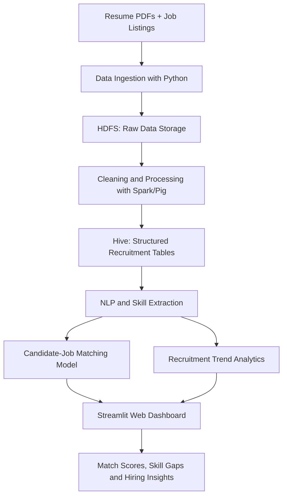

# Big Data–Driven Job Profile and Recruitment Analyzer

**Using Hadoop, Apache Hive, Apache Spark, Python NLP, and Machine Learning**

---

## 1. Project Overview

The **Job Profile Recruitment Analyzer** is a big data talent intelligence platform that analyzes job descriptions, candidate resumes, recruitment trends, and skill demands to improve the recruitment process. It processes large volumes of recruitment data using **Hadoop HDFS and Apache Hive**, extracts meaningful insights using **Python NLP and Machine Learning**, and matches candidate profiles with suitable job opportunities.

The system helps HR teams and talent acquisition professionals identify the best-fit candidates, detect skill gaps, analyze salary trends, and understand technical skill market demands with explainable, transparent metrics.

---

## 2. Technology Stack

| Layer | Recommended Technology | Usage in Project |
| :--- | :--- | :--- |
| **Data Storage** | Apache Hadoop (HDFS) | Distributed storage for 1.6M+ raw job descriptions and candidate resumes. |
| **Data Warehouse** | Apache Hive | SQL-based analysis of recruitment data, skill frequency, and salary ranges. |
| **Distributed Processing** | Apache Spark / MapReduce / Pig | Large-scale transformations, deduplication, and feature matrix construction. |
| **NLP & Text Mining** | Python, Regex Entity Normalizer, TF-IDF | Resume parsing (PDF/TXT), skill extraction, and alias normalization. |
| **Machine Learning** | Scikit-learn (KMeans, Silhouette Validation) | Clustering into $k=4$ job families and $k=9$ functional tech skill groups. |
| **Dashboard & UI** | Streamlit, Matplotlib, Seaborn | Interactive 5-module dashboard for recruiters, candidates, and analysts. |
| **Deployment** | Docker, Docker Compose, Linux | Containerized single-command local and cloud deployment. |

---

## 3. Core Project Modules

### 🔹 Module 1: Resume and Job Description Ingestion
Upload candidate resumes in **PDF or TXT** format and ingest job postings from recruitment datasets. Raw text files are archived in HDFS storage and cataloged into structured Hive tables.

### 🔹 Module 2: NLP-Based Skill Extraction
Extract core technical skills (e.g., Python, Hadoop, SQL, Java, Spark, AWS, PyTorch, Docker) from raw text. The engine normalizes spelling variations, acronyms, and related technology aliases against a canonical skills dictionary.

### 🔹 Module 3: Explainable Candidate-Job Matching Model
Compare candidate competencies against target job requirements to generate an **explainable match score (%)**. The model highlights matched strengths, pinpoints missing requirements, and provides transparent auditability.

### 🔹 Module 4: Recruitment Trend Analytics
Run Hive queries and distributed aggregations over **1.6M+ job postings** to uncover:
- Most demanded technical skills and programming languages
- Global hiring regions and top technical job titles
- Market salary range distributions (Junior, Mid-Level, Senior, Lead)
- Experience requirements and work types (Full-Time, Remote, Contract)

### 🔹 Module 5: Skill Gap and Career Recommendations
Identifies specific skill deficiencies for target career tracks and generates actionable, project-based learning roadmaps to help candidates bridge skill gaps.

---

## 4. System Architecture & Workflow



---

## 5. Illustrative Example Output

Suppose a target job requisition requires: **Python, SQL, Hadoop, Hive, and Spark**.

```
Candidate Profile:
- Skills: Python, SQL, Hadoop, Hive

Matching Result: 80% Match Score
Required Skill Coverage:
  ✅ Python (Matched)
  ✅ SQL (Matched)
  ✅ Hadoop (Matched)
  ✅ Hive (Matched)
  ❌ Apache Spark (Missing)

Actionable Career Improvement:
  "Learn Apache Spark and complete a practical distributed data-processing project processing multi-GB datasets with PySpark."
```
*Note: The 80% score is an explainable calculation based on verified requirement overlap, ensuring auditable, bias-free human-in-the-loop candidate screening.*

---

## 6. Quick Start & Deployment

### Run Locally:
```bash
# 1. Clone the repository
git clone https://github.com/itzsahil-prog/Job-Profile-Recruitment-Analyzer.git
cd Job-Profile-Recruitment-Analyzer

# 2. Set up virtual environment
python -m venv .venv
.venv\Scripts\activate  # Windows
# or: source .venv/bin/activate  # Linux/macOS

# 3. Install dependencies
pip install -r requirements.txt

# 4. Run test suite
python -m pytest tests/ -v

# 5. Launch the Streamlit Dashboard
streamlit run app.py
```

### Run with Docker Compose:
```bash
docker-compose up --build
```
Access the application at `http://localhost:8501`.

---

## 7. Directory Structure

```
bigdata/
├── app.py                      — Streamlit interactive 5-module recruitment platform
├── requirements.txt            — Python dependencies (Streamlit, Pandas, Scikit-learn, PyPDF)
├── Dockerfile                  — Container definition
├── docker-compose.yml          — Container orchestration
├── config/
│   ├── skills_dictionary.csv   — Canonical skills and alias normalization mappings
│   └── title_aliases.csv       — Job title clustering mappings
├── mapreduce/                  — Hadoop Streaming mapper & reducer scripts
├── pig/                        — Pig Latin cleaning and relational join scripts
├── hive/                       — HiveQL DDL and analytical query scripts
├── analytics/                  — Python ML clustering, vectorization, and visualization scripts
├── outputs/                    — Generated CSV/JSON analytics summaries and competence matrix
├── visualizations/             — Generated analytical charts
└── tests/                      — Automated pytest verification suite
```

---

## 8. License & Contribution
Open-source enterprise big data talent intelligence project. Contributions and issues welcome via [GitHub Issues](https://github.com/itzsahil-prog/Job-Profile-Recruitment-Analyzer/issues).
